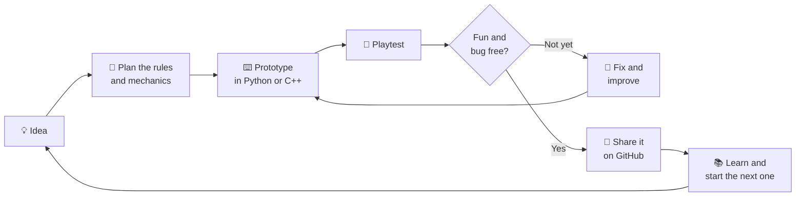
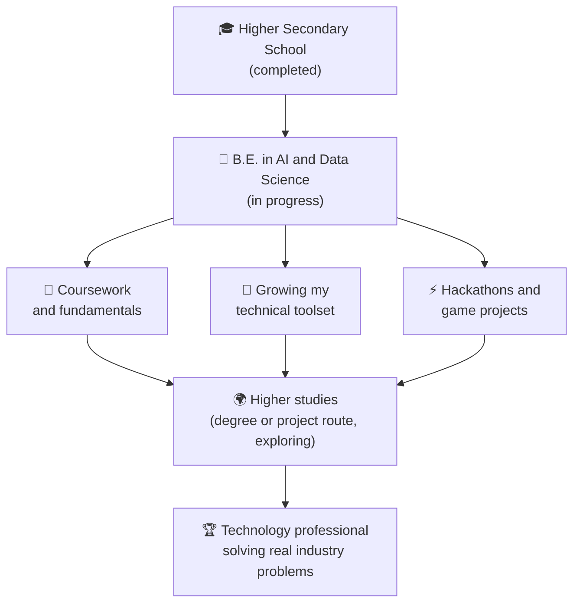

<!-- ================================================================
  GITHUB PROFILE README  |  Logitha J
  BEFORE YOU PASTE, REPLACE THESE 2 THINGS:
  1) YOUR-GITHUB-USERNAME  ->  your GitHub username (used 3 times, stats cards)
  2) YOUR-LINKEDIN-URL     ->  your LinkedIn profile link (used 1 time, LinkedIn badge)
  Repo name must be exactly your username, and README.md must be in the main branch.
================================================================= -->

 

 

## 🎮 Player Profile

| | |
|---|---|
| **Player** | Logitha J |
| **Class** | Engineering student, Artificial Intelligence & Data Science |
| **Base camp** | St. Joseph's College of Engineering, Chennai |
| **Main weapons** | C · C++ · Python |
| **Favourite zone** | Game development |
| **Current mission** | Strong coursework, a bigger toolset, and hackathons for hands-on practice |
| **Status** | Levelling up every week |

 

## 🧭 My Quest Line

> **Short-term quest:** Excel in my college coursework, upgrade my technical toolset, and join high-energy hackathons to speed up practical learning.
>
> **Long-term quest:** Grow into an accomplished technology professional at a forward-thinking organization, using my analytical background to solve complex industry challenges.

 

## 🕹️ How I Turn an Idea into a Game

Every game I build follows the same loop. Each pass through it makes the next one better.

 

## 🗺️ My Journey So Far and What Comes Next

 

## 🧩 Skill Tree

| Branch | What I use | Level |
|---|---|---|
| 💻 **Languages** | C, C++, Python | Building strong foundations |
| 🎮 **Game development** | Game logic, simple 2D game ideas, Python game libraries | Exploring and practising |
| 🤖 **AI and Data Science** | Python for data handling, basic analysis, problem solving | Learning through coursework |
| 🛠️ **Tools** | Git, GitHub, VS Code | Daily use |

 

## 📜 Quest Log (Projects)

| Quest | What it is | Tech | Status |
|---|---|---|---|
| 🐍 **python-mini-games** | Small console and 2D games such as number guessing and a simple arcade game | Python |  |
| ⚙️ **cpp-problem-solving** | C and C++ practice programs covering logic, arrays, strings and basic data structures | C · C++ |  |
| 📊 **ai-ds-coursework** | Notes and lab work from my AI and Data Science subjects | Python |  |
| 🏁 **hackathon-journal** | What I build, break and learn at each hackathon | Mixed |  |

Rename these to match the repositories you actually create.

 

## 💜 Why Games, and Why AI + Data Science

Game development is where my favourite parts of engineering meet: logic, maths and creativity. Behind every good game are rules, data and decisions: how enemies behave, how levels are balanced, how a player's score tells you what to improve. My AI and Data Science studies give me the analytical side of that, and my love for games keeps me curious enough to keep building.

 

## ⚡ Hackathon Mode

- 🎯 **Goal:** Join hackathons and game jams to learn faster by building under pressure.
- 🤝 **Team up:** Open to teammates who enjoy building, designing or debugging.
- 📝 **Habit:** After every event, write down what worked, what broke and what I will practise next.

 

## 📈 Stats

 

## 💬 Let's Connect

Open to hackathon teams, game jams and study-buddy projects. Ask me about **C, C++, Python and game development**.

📫 **Email:** [logitha02020@gmail.com](mailto:logitha02020@gmail.com)
🔗 **LinkedIn:** [Logitha J](YOUR-LINKEDIN-URL)

*"Every expert player once pressed Start for the first time."*

