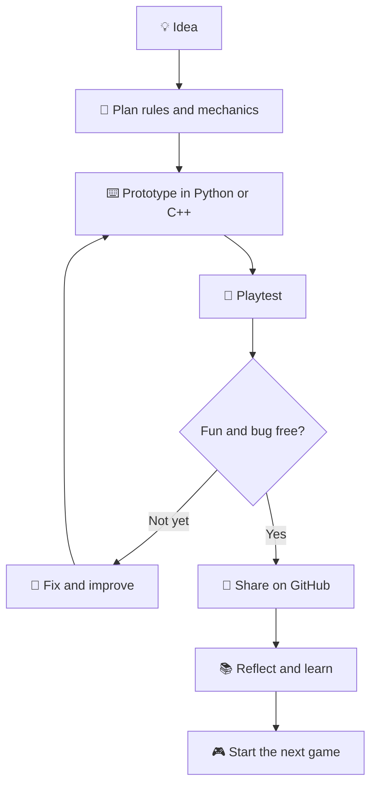
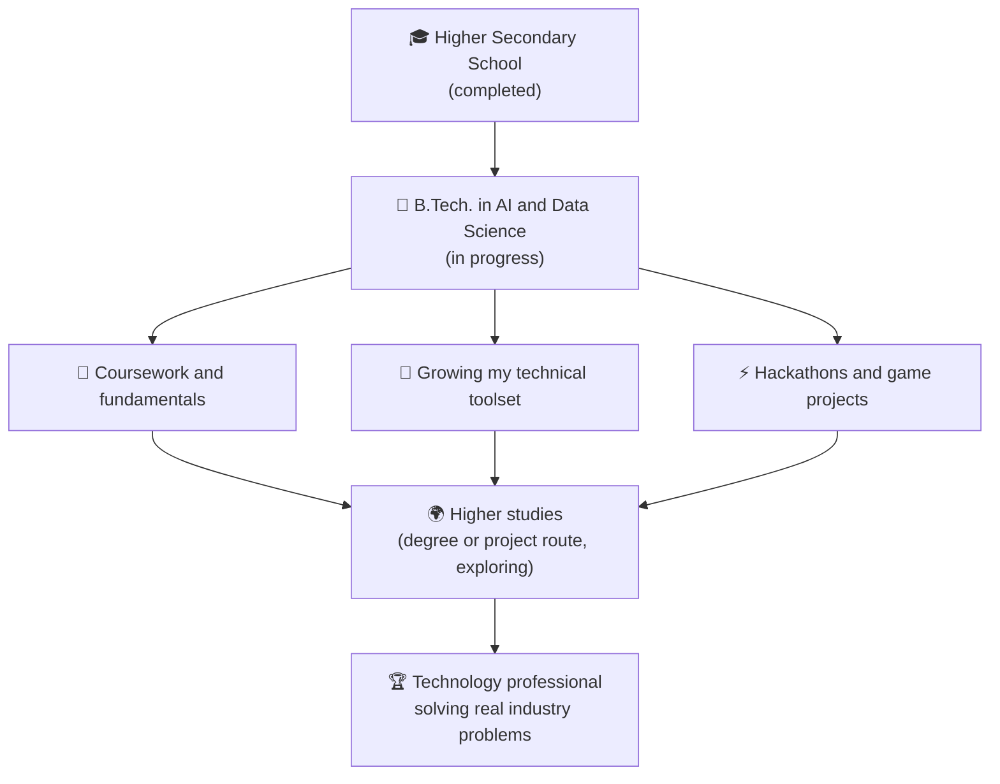

<!-- ================================================================
  GITHUB PROFILE README  |  Logitha J
  ONLY ONE THING TO REPLACE BEFORE PASTING:
  YOUR-LINKEDIN-URL  ->  your LinkedIn profile link (appears 2 times)
================================================================= -->

### B.Tech Artificial Intelligence & Data Science

**C &nbsp;•&nbsp; C++ &nbsp;•&nbsp; Python &nbsp;•&nbsp; Game Development &nbsp;•&nbsp; Hackathons**

<a href="YOUR-LINKEDIN-URL">🔗 <b>LinkedIn</b></a> &nbsp;&nbsp;|&nbsp;&nbsp;
<a href="mailto:logitha02020@gmail.com">✉️ <b>logitha02020@gmail.com</b></a> &nbsp;&nbsp;|&nbsp;&nbsp;
<a href="https://github.com/logithaj">💻 <b>GitHub</b></a>

---

## 🎮 Profile Snapshot

| | |
|---|---|
| **Name** | Logitha J |
| **Studying** | B.Tech. Artificial Intelligence & Data Science |
| **College** | St. Joseph's College of Engineering, Chennai |
| **Languages** | C, C++, Python |
| **Favourite area** | Game development |
| **Current focus** | Strong coursework, a wider technical toolset, and hackathons for hands-on practice |

 

## 🧭 Goals

> **Short-term:** Excel in my college coursework, upgrade my technical toolset, and join high-energy hackathons to speed up practical learning.
>
> **Long-term:** Grow into an accomplished technology professional at a forward-thinking organization, using my analytical background to solve complex industry challenges.

 

## 🕹️ How I Turn an Idea into a Game

Every game I build follows the same cycle, and each round makes the next one better.

 

## 🗺️ Journey and Roadmap

 

## 🧩 Skills

| Area | What I work with | Stage |
|---|---|---|
| 💻 **Programming** | C, C++, Python | Building strong foundations |
| 🎮 **Game development** | Game logic, simple 2D game ideas, Python game libraries | Exploring and practising |
| 🤖 **AI and Data Science** | Python for data handling, basic analysis, problem solving | Learning through coursework |
| 🛠️ **Tools** | Git, GitHub, VS Code | Daily use |

 

## 📂 Projects

| Project | What it is | Tech | Status |
|---|---|---|---|
| 🐍 **python-mini-games** | Small console and 2D games such as number guessing and a simple arcade game | Python | 🟡 In progress |
| ⚙️ **cpp-problem-solving** | C and C++ practice programs covering logic, arrays, strings and basic data structures | C, C++ | 🔵 Ongoing |
| 📊 **ai-ds-coursework** | Notes and lab work from my AI and Data Science subjects | Python | 🔵 Ongoing |
| 🏁 **hackathon-journal** | What I build, break and learn at each hackathon | Mixed | ⚪ Starting |

Rename these to match the repositories you actually create.

 

## 💜 Why Games, and Why AI + Data Science

Game development is where my favourite parts of engineering meet: logic, maths and creativity. Behind every good game are rules, data and decisions, such as how enemies behave, how levels are balanced and how a player's score shows what to improve. My AI and Data Science studies give me the analytical side of that, and my love for games keeps me curious enough to keep building.

 

## ⚡ Hackathons

- 🎯 **Goal:** Join hackathons and game jams to learn faster by building under pressure.
- 🤝 **Collaboration:** Open to teammates who enjoy building, designing or debugging.
- 📝 **Habit:** After every event, write down what worked, what broke and what to practise next.

 

## 💬 Let's Connect

Open to hackathon teams, game jams and study-buddy projects. Ask me about **C, C++, Python and game development**.

- ✉️ **Email:** [logitha02020@gmail.com](mailto:logitha02020@gmail.com)
- 🔗 **LinkedIn:** [Logitha J](YOUR-LINKEDIN-URL)

*"Every expert player once pressed Start for the first time."*

